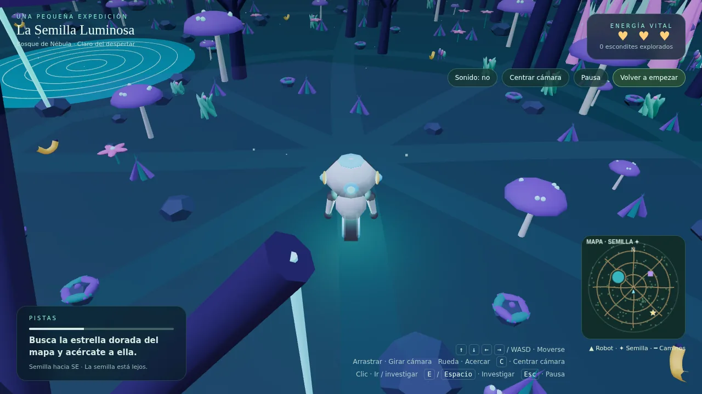

# La Semilla Luminosa

Juego 3D de exploración para navegador. Guía a **Blip**, un pequeño robot, por un bosque alienígena, esquiva trampas camufladas y encuentra **La Semilla Luminosa** para devolver la luz al bosque.

## Cómo jugar

- Empiezas con **3 vidas**. Investigar un escondite vacío o caer en una trampa cuesta una.
- Los **plátanos dorados** recuperan una vida (máximo 3) y se gastan al usarlos.
- Los **brotes extraños** te cortan el paso: debes investigarlos (E, Espacio o botón «Investigar») antes de seguir. Pueden ser una trampa que te quita una vida o una bonificación. No hay forma de saberlo de antemano.
- Los **hoyos camuflados** del suelo se activan al pisarlos y también quitan una vida.
- El **protector de trampas** es una bonificación de un solo uso: absorbe la próxima trampa (brote u hoyo). Mientras lo lleves sin usar, no puedes ganar otra bonificación.
- No hay caminos obligatorios: puedes moverte por todo el bosque esquivando obstáculos.
- La semilla, los brotes, las bonificaciones y los hoyos cambian de sitio en cada partida. El mapa marca la semilla con una estrella dorada.

### Controles

| Dispositivo | Controles |
|---|---|
| Ordenador | Flechas o WASD para moverte · arrastrar para girar la cámara · rueda para acercar · E o Espacio para investigar · C para centrar la cámara · Esc para pausar |
| Móvil / tableta | Botones de dirección o tocar el suelo · arrastrar para girar · pellizcar para acercar · botón «Investigar» |

## Compatibilidad

Funciona en los navegadores actuales de ordenador, móvil y tableta (Chrome, Edge, Firefox y Safari de los últimos años), en vertical y en horizontal. Si el dispositivo no admite WebGL, el juego usa automáticamente un modo de dibujo alternativo, más sencillo.

## Ejecutarlo

Es un único archivo, `index.html`, sin dependencias externas ni instalación (la biblioteca three.js va incluida). Ábrelo con doble clic en cualquier navegador.

## Publicarlo con GitHub Pages

1. En el repositorio, entra en **Settings → Pages**.
2. En **Build and deployment**, elige **Deploy from a branch**, la rama `main` y la carpeta `/ (root)`.
3. Pulsa **Save** y espera un par de minutos: GitHub te mostrará el enlace del juego.

## Créditos

Usa [three.js](https://threejs.org/) (licencia MIT), incluida en el propio archivo `index.html`.
